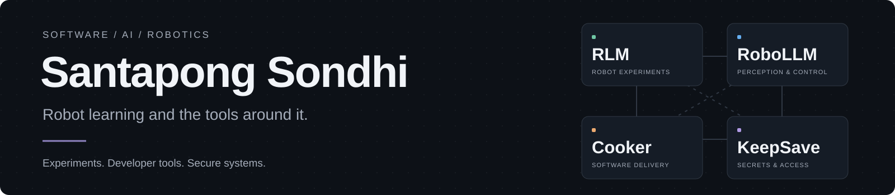
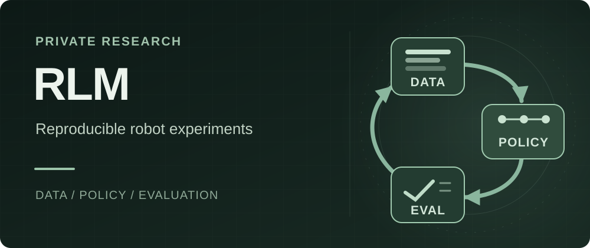
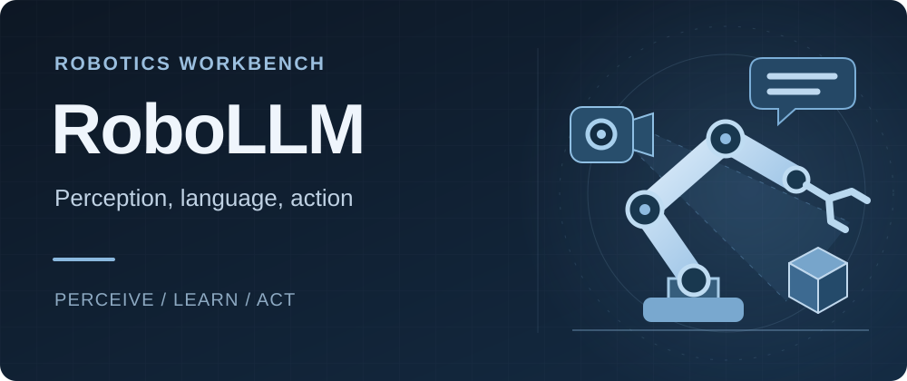
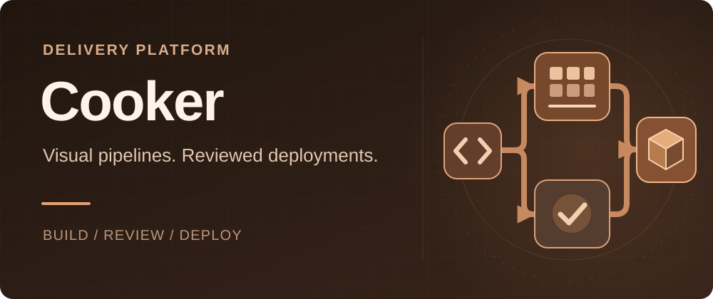
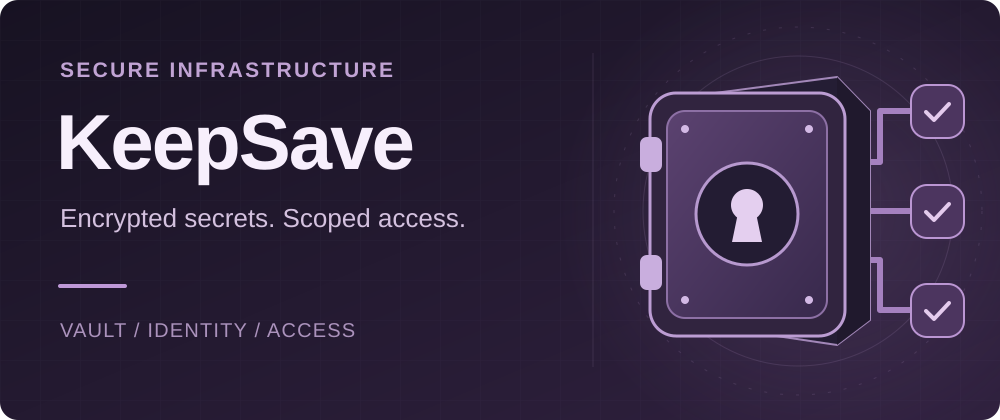

<picture>
  <source media="(prefers-color-scheme: light)" srcset="assets/profile-cover-light.svg" />
  
</picture>

  <a href="#on-my-workbench"><b>Projects</b></a> &nbsp; / &nbsp;
  <a href="https://resume.draveniq.dev/blog"><b>Field Notes</b></a> &nbsp; / &nbsp;
  <a href="https://resume.draveniq.dev">Portfolio</a> &nbsp; / &nbsp;
  <a href="https://resume.draveniq.dev/resume">Resume</a> &nbsp; / &nbsp;
  <a href="https://www.linkedin.com/in/santapong-sondhi-11176034b">LinkedIn</a> &nbsp; / &nbsp;
  <a href="mailto:santapongsondhi@gmail.com">Connect</a>

I’m **Santapong**, a software, AI and robotics engineer from Thailand. I love building things—and seeing an idea become something that runs, learns, or moves.

## Why I build

My long-term ambition is **embodied AGI and general-purpose humanoid robots**: machines that can understand the world, learn useful skills, and act within it. That is the future I want to help build.

My grounding is practical: **Automation Engineering at KMITL**, manufacturing software, an industrial robotics pilot, and developer-platform work. I’m interested in the whole journey from an idea to a system we can observe, test, and improve.

Today, that curiosity takes two connected directions: **teaching robots to learn** and **building useful tools for the people doing the work**. RLM and RoboLLM explore experiments, perception, language and action. Cooker and KeepSave reflect the same builder’s instinct through software delivery and controlled access.

The bigger questions keep me coming back: how intelligence generalizes, how robots learn across bodies, and what it takes to turn a promising experiment into something useful.

## On my workbench

<table>
<tr>
<td width="50%" valign="top">

### RLM
**Learn through experiments**

A Python framework for repeatable robot-learning workflows: collect episodes, replay runs, train and evaluate policies, and compare embodiments.

Python · MuJoCo · Robot learning

**Private research** · [Ask about the work ↗](mailto:santapongsondhi@gmail.com?subject=RLM%20research)

</td>
<td width="50%" valign="top">

### [RoboLLM](https://github.com/santapong/RoboLLM)
**Connect perception, language and action**

A robotics workbench for perception, teleoperation and language-guided control. UR5e experiments in MuJoCo explore learned policies and camera-view shifts.

Python · ROS 2 · MuJoCo · PyTorch

[Explore the workbench ↗](https://github.com/santapong/RoboLLM) · [VLA experiments ↗](https://github.com/santapong/RoboLLM/tree/experiment/ur5e-vla-bed/sim/vla-bed)

</td>
</tr>
<tr>
<td width="50%" valign="top">

### [Cooker](https://github.com/santapong/Cooker/tree/develop)
**Turn code into running systems**

Visual CI/CD and reviewed GitHub Compose deployments. Follow builds, approvals and execution through a graph in a self-hosted application.

Go · React · Docker · CI/CD

[Explore Cooker ↗](https://github.com/santapong/Cooker/tree/develop)

</td>
<td width="50%" valign="top">

### [KeepSave](https://github.com/santapong/KeepSave)
**Protect the systems behind the work**

A developer vault for encrypted project credentials, scoped access, secret history and recoverable backups. Built around explicit control over who can access what.

Go · React · PostgreSQL · Access control

[Explore KeepSave ↗](https://github.com/santapong/KeepSave) · [Website ↗](https://keepsave.draveniq.dev)

</td>
</tr>
</table>

Project illustrations represent each project's focus; source repositories describe implementation and validation status.

## From the field notes

I share what I build, what fails, and what I want to understand next. Sometimes the same engineering questions follow me outside the lab.

- **Robot learning:** [Embodied AI vs Cross-Embodiment AI: Where the Line Actually Sits](https://resume.draveniq.dev/blog/embodied-ai-vs-cross-embodiment)
- **Engineering:** [AI Proposes, Safety Decides](https://resume.draveniq.dev/blog/ai-proposes-safety-decides)
- **Beyond the keyboard:** [The Wind Window Is a State Space](https://resume.draveniq.dev/blog/kitesurfing-wind-window-control)

<b>Inside the toolbox</b>

- **Robotics & learning:** Python · ROS 2 · MuJoCo · PyTorch
- **Software & infrastructure:** Go · TypeScript · React · FastAPI · PostgreSQL · Docker · Linux
- **Working habits:** reproducible experiments, inspectable execution, and clear boundaries between simulation and hardware evidence.

Still banner options

[Dark](assets/profile-cover-dark-static.svg) · [Light](assets/profile-cover-light-static.svg)

---

**An interesting engineering problem is a good reason to connect.** [Email](mailto:santapongsondhi@gmail.com) · [LinkedIn](https://www.linkedin.com/in/santapong-sondhi-11176034b) · [More projects](https://resume.draveniq.dev/projects)
