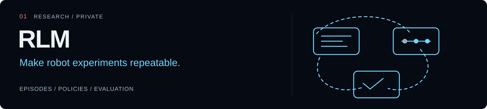
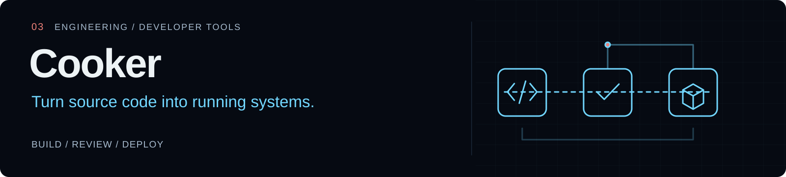

<picture>
  <source media="(max-width: 600px) and (prefers-color-scheme: light)" srcset="assets/profile-cover-mobile-light.svg" />
  <source media="(max-width: 600px)" srcset="assets/profile-cover-mobile-dark.svg" />
  <source media="(prefers-color-scheme: light)" srcset="assets/profile-cover-light.svg" />
  
</picture>

  <a href="#on-my-workbench"><b>Explore my work</b></a> &nbsp; · &nbsp;
  <a href="https://resume.draveniq.dev/blog"><b>Field notes</b></a> &nbsp; · &nbsp;
  <a href="https://resume.draveniq.dev">Portfolio</a> &nbsp; · &nbsp;
  <a href="https://resume.draveniq.dev/resume">Resume</a> &nbsp; · &nbsp;
  <a href="https://www.linkedin.com/in/santapong-sondhi-11176034b">LinkedIn</a>

## I like the moment an idea starts doing something.

A robot moves. An experiment becomes repeatable. A tool makes someone's work a little easier.

I'm **Santapong Sondhi**, a software, AI and robotics engineer from Thailand. My background is in **Automation Engineering at KMITL**, manufacturing software, an industrial robotics pilot, and developer platforms. I enjoy connecting the pieces: code, learning, machines, and the people who use them.

**DraveNIQ is the identity I build under.** To me, it stands for curiosity, the courage to explore, and learning by making. The dragon carries that spirit; the work gives it substance.

### The future I want to help build

My long-term ambition is **embodied AGI and general-purpose humanoid robots**: intelligence that can learn useful skills, adapt to unfamiliar situations, and act in the world.

The questions that pull me in:

- **From seeing to doing:** how do perception and language become useful robot actions?
- **Across bodies:** what can a robot carry over when its embodiment changes?
- **Beyond one good run:** how do we make experiments repeatable and understand why they fail?

That curiosity takes two connected paths: **robots that learn** and **tools that help people build**.

## On my workbench

### 01 · RLM — learning through experiments

A Python framework for repeatable robot-learning workflows: collect episodes, replay runs, train and evaluate policies, and explore learning across embodiments. The question behind it: **can the next experiment teach us more than the last one?**

Python · MuJoCo · Robot learning

**Private research** · [Let's talk about the work ↗](mailto:santapongsondhi@gmail.com?subject=RLM%20research)

### 02 · RoboLLM — connecting perception, language and action

A robotics workbench for perception, teleoperation and language-guided control. My UR5e experiments in **MuJoCo simulation** explore learned policies and camera-view shifts: **what changes when the robot sees the task differently?**

Python · ROS 2 · MuJoCo · PyTorch

[Explore RoboLLM ↗](https://github.com/santapong/RoboLLM) · [Inside the VLA experiments ↗](https://github.com/santapong/RoboLLM/tree/experiment/ur5e-vla-bed/sim/vla-bed)

### 03 · Cooker — turning code into running systems

A self-hosted visual CI/CD application for pipelines and reviewed GitHub Compose deployments. I want the journey from source to execution to be something you can **see, inspect, and understand**.

Go · React · Docker · CI/CD

[Explore Cooker ↗](https://github.com/santapong/Cooker/tree/develop) · [Follow the delivery work ↗](https://github.com/santapong/Cooker/blob/develop/docs/README.md)

### 04 · KeepSave — giving access clear boundaries

A developer vault for encrypted project credentials, scoped access, secret history and recoverable backups. It asks a practical question: **who should be able to access what, and how do we keep that decision explicit?**

Go · React · PostgreSQL · Access control

[Explore KeepSave ↗](https://github.com/santapong/KeepSave) · [Visit the website ↗](https://keepsave.draveniq.dev)

These are projects in progress. Illustrations express their focus; linked repositories carry implementation and validation status. RLM remains private, and simulation experiments are described as simulation.

## How I like to work

**Ask a useful question → build a small version → observe what happens → make the next version better.**

I care about reproducible experiments, inspectable systems, and understanding the failure as well as the successful run. A promising demo makes me curious about the next test.

<b>Inside my toolbox</b>

- **Robotics & learning:** Python · ROS 2 · MuJoCo · PyTorch
- **Software & infrastructure:** Go · TypeScript · React · FastAPI · PostgreSQL · Docker · Linux
- **Interests:** embodied AI · vision-language-action · cross-embodiment learning · developer tools

## Notes from the work, and the world outside it

I write to make sense of what I'm building. Sometimes the same engineering questions follow me beyond the keyboard.

| A question I'm exploring | A field note |
| --- | --- |
| What changes when intelligence gets a different body? | [Embodied AI vs Cross-Embodiment AI](https://resume.draveniq.dev/blog/embodied-ai-vs-cross-embodiment) |
| Where should an AI's proposal meet an engineering boundary? | [AI Proposes, Safety Decides](https://resume.draveniq.dev/blog/ai-proposes-safety-decides) |
| What can the wind teach us about control? | [The Wind Window Is a State Space](https://resume.draveniq.dev/blog/kitesurfing-wind-window-control) |

[Read more field notes ↗](https://resume.draveniq.dev/blog) · [Browse more projects ↗](https://resume.draveniq.dev/projects)

---

### Have a question worth building around?

I'm happy to connect over **robot learning, embodied AI, developer tools, or an interesting engineering problem**.

[Start a conversation ↗](mailto:santapongsondhi@gmail.com) · [Connect on LinkedIn ↗](https://www.linkedin.com/in/santapong-sondhi-11176034b)

Artwork & still banners

Original DraveNIQ artwork from my supplied logo kit, with project illustrations created for this profile. [Artwork notes](assets/brand/README.md).

[Dark still banner](assets/profile-cover-dark-static.svg) · [Light still banner](assets/profile-cover-light-static.svg)

