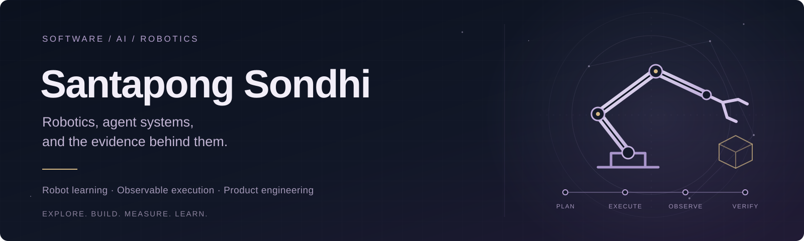

**Software, AI & Robotics Engineer · Thailand**

[**Portfolio ↗**](https://resume.draveniq.dev) &nbsp; · &nbsp; [**Field Notes ↗**](https://resume.draveniq.dev/blog) &nbsp; · &nbsp; [Resume](https://resume.draveniq.dev/resume) &nbsp; · &nbsp; [LinkedIn](https://www.linkedin.com/in/santapong-sondhi-11176034b) &nbsp; · &nbsp; [Email](mailto:santapongsondhi@gmail.com)

 

I’m **Santapong Sondhi**. I work where intelligent software meets real engineering constraints: robot policies that encounter a different camera view, coding agents whose decisions need to be traced, and business tools that need to make everyday work easier.

My work spans **robot learning, dependable agent systems, and product engineering**. My research direction is **embodied AI, vision-language-action (VLA) models, and cross-embodiment learning**—especially how to evaluate what a system has learned and where it stops generalizing.

**Background:** B.Eng. Automation Engineering, KMITL · Manufacturing software · Industrial robotics pilot · Developer platforms

## Selected work

<table>
<tr>
<td width="50%" valign="top">

### [RoboLLM](https://github.com/santapong/RoboLLM)
**Experiments in robot learning**

A robotics workbench connecting perception, teleoperation, and learned control. UR5e experiments in MuJoCo examine policy behavior under camera shifts, with reproducible evaluation artifacts.

Python · ROS 2 · MuJoCo · PyTorch

[Explore the workbench ↗](https://github.com/santapong/RoboLLM) &nbsp; [VLA experiments ↗](https://github.com/santapong/RoboLLM/tree/experiment/ur5e-vla-bed/sim/vla-bed)

</td>
<td width="50%" valign="top">

### [Accretion](https://github.com/santapong/Accretion)
**Observable execution for coding agents**

A provider-neutral control plane for local AI coding agents. Deterministic planning, verifier-gated loops, isolated Git worktrees, and durable traces make execution inspectable.

Python · FastAPI · React · PostgreSQL

[Explore the control plane ↗](https://github.com/santapong/Accretion)

</td>
</tr>
<tr>
<td width="50%" valign="top">

### [Signoff](https://github.com/santapong/signoff/tree/develop)
**A closer look at robot task cycles**

Camera-based measurement and an Evidence Workbench connecting original footage, cycle timelines, annotations, and qualification reports. Built for engineers to inspect the observations behind a measurement.

Python · Computer vision · Video analysis

[Explore the workbench ↗](https://github.com/santapong/signoff/tree/develop)

</td>
<td width="50%" valign="top">

### [StockFlow](https://resume.draveniq.dev/projects/17-stockflow)
**Inventory with a view of cash flow**

Inventory and cash-flow software for Thai SMEs. A product engineering project connecting stock management with the financial questions behind day-to-day business decisions.

Business software · Inventory · Cash flow

[Read the product case study ↗](https://resume.draveniq.dev/projects/17-stockflow)

</td>
</tr>
</table>

**Also building:** [Cooker](https://github.com/santapong/Cooker/tree/develop), visual CI/CD and reviewed container deployments · [Proof](https://github.com/santapong/Proof), composable engineering workflows for Claude Code.

**Research & exploration:** [xembodiment-lit](https://github.com/santapong/xembodiment-lit), source-backed reading on embodied AI and cross-embodiment learning · [Trajectory](https://github.com/santapong/Trajectory), robot path planning for jewelry manufacturing.

## Questions that guide the work

- **Generalization:** how robot policies behave when the camera, task, or embodiment changes.
- **Observability:** how to follow an agent’s decisions from intent through execution and verification.
- **Evaluation:** how to turn experiments and recorded observations into evidence someone else can inspect.

I build around concrete questions, inspectable execution, and measurements that can challenge the result. Simulation results, hardware readiness, and demonstrated transfer each need their own evidence.

## Engineering toolkit

| Robotics & learning | Agents & backend | Products & infrastructure |
| :--- | :--- | :--- |
| Python · ROS 2 · MuJoCo · PyTorch | MCP · FastAPI · Go · PostgreSQL | TypeScript · React · Next.js · Docker · Linux |

## Beyond the repository

I write [**Field Notes**](https://resume.draveniq.dev/blog) about the ideas, experiments, and engineering decisions behind the work. The [**portfolio**](https://resume.draveniq.dev/projects) brings the projects and their context together.

For research conversations, technical collaboration, or an interesting engineering problem: **[let’s connect ↗](mailto:santapongsondhi@gmail.com)**.
