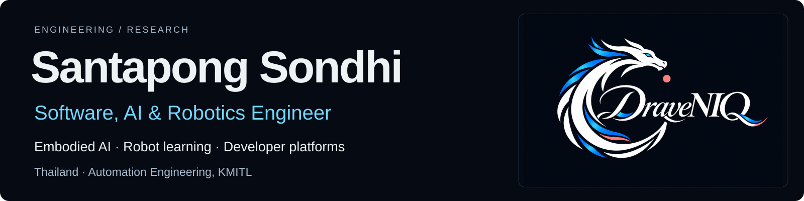
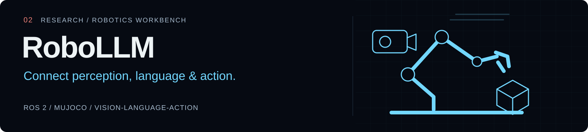
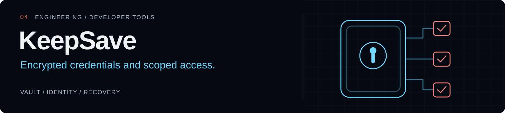

<picture>
  <source media="(max-width: 600px)" srcset="assets/profile-cover-mobile-dark.svg" />
  <source media="(prefers-color-scheme: light)" srcset="assets/profile-cover-light.svg" />
  
</picture>

  <a href="#selected-work"><b>Projects</b></a> &nbsp; · &nbsp;
  <a href="#research-interests">Research</a> &nbsp; · &nbsp;
  <a href="https://resume.draveniq.dev">Portfolio</a> &nbsp; · &nbsp;
  <a href="https://resume.draveniq.dev/resume">Resume</a> &nbsp; · &nbsp;
  <a href="https://www.linkedin.com/in/santapong-sondhi-11176034b">LinkedIn</a>

## Engineering profile

I'm **Santapong Sondhi**, a software, AI and robotics engineer based in Thailand. My background combines **Automation Engineering at KMITL** with manufacturing software, an industrial robotics pilot, and developer-platform work.

My focus is on **robot-learning experiments and developer infrastructure**: building systems that can be inspected, evaluated and improved. **DraveNIQ** brings together my independent engineering projects and research interests.

## Selected work

### RLM · Robot-learning experiment framework

A Python framework for collecting and replaying episodes, training and evaluating policies, and organizing repeatable robot-learning experiments.

Python · MuJoCo · Robot learning

**Private research** · [Research enquiries](mailto:santapongsondhi@gmail.com?subject=RLM%20research)

### RoboLLM · Robotics and VLA workbench

A ROS 2 workbench for perception, teleoperation and language-guided control. UR5e experiments in **MuJoCo simulation** examine learned policies and camera-view shifts.

Python · ROS 2 · MuJoCo · PyTorch

[Repository](https://github.com/santapong/RoboLLM) · [VLA experiments](https://github.com/santapong/RoboLLM/tree/experiment/ur5e-vla-bed/sim/vla-bed)

### Cooker · Visual software delivery

A self-hosted application for visual CI/CD pipelines and reviewed GitHub Compose deployments, with dependency graphs, approval stages and execution logs.

Go · React · Docker · CI/CD

[Repository](https://github.com/santapong/Cooker/tree/develop) · [Documentation](https://github.com/santapong/Cooker/blob/develop/docs/README.md)

### KeepSave · Developer credential management

A developer vault for encrypted project credentials, scoped access, immutable secret history and encrypted backup and recovery workflows.

Go · React · PostgreSQL · Access control

[Repository](https://github.com/santapong/KeepSave) · [Website](https://keepsave.draveniq.dev)

Project illustrations are conceptual. Linked repositories document implementation, validation and release status.

## Research interests

**Embodied AI · Vision-language-action models · Cross-embodiment learning**

I'm interested in how robots connect perception and language to action, transfer skills across embodiments, and learn through reproducible experiments. My long-term research ambition is **embodied AGI and general-purpose humanoid robotics**.

## Technical focus

- **Robotics & machine learning:** Python, ROS 2, MuJoCo, PyTorch
- **Backend & infrastructure:** Go, FastAPI, PostgreSQL, Docker, Linux
- **Frontend:** TypeScript, React

## Selected writing

- [Embodied AI vs Cross-Embodiment AI](https://resume.draveniq.dev/blog/embodied-ai-vs-cross-embodiment) — distinctions and research directions.
- [AI Proposes, Safety Decides](https://resume.draveniq.dev/blog/ai-proposes-safety-decides) — engineering boundaries around AI-assisted decisions.

[More writing](https://resume.draveniq.dev/blog) · [More projects](https://resume.draveniq.dev/projects)

---

**Engineering collaboration & research enquiries**

[Email](mailto:santapongsondhi@gmail.com) · [LinkedIn](https://www.linkedin.com/in/santapong-sondhi-11176034b) · [Resume](https://resume.draveniq.dev/resume)

Artwork

DraveNIQ signature from the supplied logo kit. [Artwork and source notes](assets/brand/README.md).

